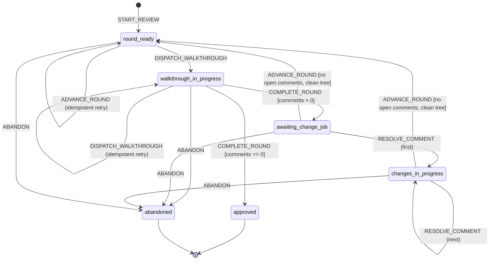

# Interactive, iterative code review loop (VS Code)

## Status (2026-11-13)

Phase 0 and Phase 1 are built, and the lifecycle has been redone as an
explicit state machine (see "State machine" below) — the motivating gap:
round 1 of a real review finished its change job and reported, but nothing
moved the review to round 2 in a way Jay actually noticed; he had to go
looking. The old lifecycle tracked this as `session.status` flipping back
to `"walkthrough"` the instant a round's diff was computed, with nothing
distinguishing "ready to walk" from "a walkthrough job is actually
running" — so there was no single moment a round becoming ready could hook
a notification into. `api/lib/review-fsm.js` is now the only thing that
changes a review's lifecycle state; every route in `api/review.js` calls
it instead of writing `status`/`completedAt` by hand, and the "a round is
ready, tell Pearl" step is a required transition effect
(`notify_pearl_round_ready`) rather than a courtesy left to a dispatched
agent's own end-of-job report.

Other changes from the original plan below:

- **Walk order:** rounds are grouped by logic and data flow
  (`PUT .../round/:n/groups`, every chunk in exactly one group), and walked
  one element at a time, with caller context pulled in only when it's worth
  it. VS Code shows a real diff (`code --diff`) against the round's base.
- **Voice:** generic `/api/voice/:id/speak|hush` (`api/voice.js`, shared
  mechanics in `api/lib/speak.js`), on by default for walkthroughs.
- **Full-feature context:** `session.rootBaseSha` lets any round see the
  whole branch, not just its own incremental diff.
- **Phase 1 decisions (Jay):** one local commit per round, never pushed; the
  change agent stops and asks before any push-back, so it runs interactive;
  closing a round auto-dispatches the change agent
  (`context: {type: "review", id, role: "changes"}`). Open questions 4
  (how "satisfied" is declared: Jay says so, or a round with no new
  comments) and 5 (push-back) are settled.
- **Still open:** the dashboard Reviews list (Phase 2), the supervisor
  offering to start round N+1 on the change agent's report, and range
  highlighting (`code --goto` can only place a cursor, so it needs a custom
  extension, Phase 3).

A new Command Center capability: an agent walks Jay through a diff in VS
Code, chunk by chunk, with a checklist; Jay leaves comments on specific
changes; a second agent makes the changes and reports resolved/pushed-back
per comment; the next round shows only what changed since, matched back to
each comment; repeat until Jay is satisfied.

Built from scratch. Does not reuse or retrofit `jay-pr-review`,
`jay-pr-walkthrough`, `pr-chat`, `pr-execute-plan`, or `cop-fight` — those
solve one-shot review/fix, not a multi-round, VS-Code-driven, stateful loop.

## Recap of how Command Center already works (context for the decisions below)

- `api/server.js` holds every REST route. Routes return `{ok, ...}` /
  `{ok: false, error}`, use `400/404/409` the way existing routes do.
- `api/run-command.js` runs every agent as its own tmux session (`ccenter-<id>`),
  tracked as a *job*. Jobs are independent, short-lived, bounded units — no
  agent-to-agent handoff inside the dashboard today; agents talk to Pearl via
  `SendMessage`, and Pearl (or Jay) starts the next job.
- `api/brain.js` is the closest existing precedent for "a dispatched agent's
  working state lives in a per-id directory under `~/.commandcenter/`,
  read by a polling API route, written directly to disk by the agent." No
  SQL anywhere in this codebase — the filesystem is the database for
  anything scoped to one id.
- `commands/cc-*.md` is one skill per dashboard capability, loaded only when
  needed, kept in sync with routes per `CLAUDE.md`'s own rule ("When you add
  or change an API route, update the matching `cc-*` skill in the same
  change").
- Write actions always run — no env gate, no toggle (`README.md`,
  `CLAUDE.md`). This feature follows the same posture: no permission dance
  beyond what `claude --permission-mode auto` already does for every
  dispatched job.

## What VS Code integration is actually feasible (researched, not assumed)

Checked the current Claude Code VS Code extension docs and the VS Code
extension API docs directly, rather than assuming either "the extension has
a rich API" or "nothing is possible without a custom extension."

**No public API for driving the extension from outside.** The only external
surface is a URI handler:

```
vscode://anthropic.claude-code/open?prompt=...   (pre-fills, doesn't submit)
vscode://anthropic.claude-code/open?session=...  (resumes a session)
```

Neither takes a file or line. There's no documented way for an external
process to tell the *extension* "open this file at this line." `code
--goto <path>:<line>` is real, but it's plain VS Code CLI, not anything
Claude-specific — it works whether or not the extension is installed, as
long as the `code` shell command is on `PATH` (Shell Command: Install
'code' command in PATH — a one-time VS Code setup step, not something this
feature can do for Jay).

**What a connected CLI session gets, as a side effect of normal tool use.**
When a terminal `claude` session runs `/ide` (or is launched from inside
VS Code's own integrated terminal) and connects to the IDE's local MCP
server, Claude's own Read/Edit/diff tool calls are documented to render
through VS Code's native diff viewer, honor your current selection, and
save through the IDE rather than a bare file write. This is described in
the docs as "built-in IDE MCP server" plumbing for the CLI, not a stable,
documented contract — it's real today, but not something to build a hard
dependency on, and it's unclear from the docs alone whether a tmux-backed,
iTerm2-opened session (how every Command Center job runs today) finds and
attaches to a VS Code window the same way a session started *inside* VS
Code's terminal does. That's an assumption to verify in Phase 0, not a
given.

**Comments API exists, but only inside a custom extension.** VS Code's
`vscode.comments.createCommentController` is exactly the "right-click a
line, type a comment, it lands in a gutter thread" UX Jay describes
("leaves comments on specific changes"). The Claude Code extension doesn't
expose this to other code — building it means writing a small VS Code
extension of our own.

**Decision for v1: no custom extension.** Use `code --goto <path>:<line>`
(stable, documented, zero new code to maintain) as the mechanism for "open
the actual file and line in VS Code" during the walkthrough. Treat the
`/ide`-connected native diff viewer as a nice-to-have that may or may not
show up depending on how the job's terminal was started — don't design
anything so it breaks if it doesn't. Treat "leaves comments on specific
changes" as **chat-mediated**: Jay types the comment in his reply to the
walkthrough agent, referencing the chunk/file/line the agent just opened,
and the agent is responsible for capturing it in structured form (see
below). This is the single biggest UX gap against the ideal (a line-level
gutter comment is nicer than "on the thing you just showed me, do X" typed
in chat) — it's called out again in Phase 3 rather than blocking v1 on it.

## Where review state lives

New per-review directory, same shape as Brain View's per-job directory:

```
~/.commandcenter/review/<reviewId>/
  session.json          review-level metadata (see below)
  rounds/
    1.json               round 1: diff range, chunks, checklist
    2.json               round 2: diff range, chunks, checklist
    ...
  comments.jsonl         append-only ledger of every comment, every round
```

`reviewId` is a fresh UUID, generated at `POST /api/review/start` the same
way `jobId` is generated at `POST /api/dispatch` — before any job exists,
since both the first job's prompt and its `--add-dir` need the path ahead
of time.

**`session.json`** (rewritten in place — one writer at a time, see handoff
section below):

```json
{
  "id": "…",
  "repo": "/Users/jayshaffer/dev/foo",
  "prUrl": "https://github.com/org/foo/pull/123",
  "baseBranch": "main",
  "state": "round_ready" | "walkthrough_in_progress" | "awaiting_change_job" | "changes_in_progress" | "approved" | "abandoned",
  "currentRound": 2,
  "createdAt": "…",
  "updatedAt": "…"
}
```

(Originally `status`, with three ad hoc string values and no `state`
field at all — see "State machine" below. `getSession()` migrates an old
`session.json` to this shape the first time it's read.)

**`rounds/<n>.json`** (owned entirely by the job for that round — the
walkthrough job while it's open, then frozen once that round's `complete`
fires):

```json
{
  "round": 2,
  "baseSha": "<round 1's headSha>",
  "headSha": "<repo HEAD when this round started>",
  "chunks": [
    { "id": "c1", "file": "api/foo.js", "hunkRange": "L40-L85",
      "checklist": [
        { "id": "k1", "text": "New branch has a test", "status": "pending" }
      ],
      "status": "pending" | "shown" | "done" }
  ],
  "startedAt": "…",
  "completedAt": null
}
```

**`comments.jsonl`** — one JSON object per line, append-only:

```json
{"id":"cm_1","round":1,"chunkId":"c1","file":"api/foo.js","line":42,"text":"…","status":"open","createdAt":"…"}
{"id":"cm_1","round":1,"chunkId":"c1","file":"api/foo.js","line":42,"text":"…","status":"resolved","resolution":"Added the null check.","resolvedInRound":2,"resolvedAt":"…"}
```

A comment's current state is "the last line with that `id`" — the ledger
is the append log, not a mutable record, so the walkthrough job (writer
during the comment-leaving phase of a round) and the change job (writer
during the resolving phase of the *next* round) never touch the same line
at the same time, and a reader just folds the log to the latest entry per
`id`. This sidesteps the classic "two writers touch one JSON file, last
write wins" hazard that a single mutable `comments.json` would have —
reliability rule #2 (safe to run concurrently, or guard it) satisfied by
construction (append-only + strictly alternating ownership window) rather
than by adding a lock file.

**Why not store this in Jira** (a ticket comment, a ticket's description):
this is Command Center's own bookkeeping for a review *session*, which may
or may not correspond 1:1 with a Jira ticket (reviewing an ad hoc branch
with no ticket is a legitimate use), and the data is structured (chunk ids,
line numbers, round numbers) in a way that fights Jira's ADF format and
comment-length practicality. Jira already has a role here — the PR/ticket
itself — but the review loop's working state follows the project's existing
convention of filesystem-under-home-dir for anything per-session.

## Round diff computation

Round *N*'s diff is always **incremental**, not cumulative — exactly what
the spec asks for ("shows only what changed since the last pass"):

- Round 1: `baseSha` = the merge-base of the PR's base branch (resolved via
  `git merge-base <baseBranch> HEAD`, not just `<baseBranch>` itself, so a
  base branch that's moved since the feature branch forked doesn't leak
  unrelated upstream commits into round 1). `headSha` = `HEAD` when
  `/api/review/start` is called.
- Round *N* (*N* > 1): `baseSha` = round *N-1*'s `headSha`. `headSha` =
  `HEAD` when the change agent finishes and calls the `next` route. Plain
  `git diff <baseSha>..<headSha>` in the resolved repo root (same
  `resolveRepoRoot` helper `api/dispatch` already uses) produces exactly
  the changes made in response to round *N-1*'s comments — nothing older.
- Chunking: for v1, chunk by file, one chunk per changed file, in diff
  order, each chunk carrying its own hunk ranges. (Open question #2 below —
  very large single-file diffs may need splitting later, deliberately
  deferred rather than guessed at.)
- Matching a round's chunks back to the comments that caused them: the
  change agent, while making a change, records which open comment id(s) it
  was addressing in that file into the chunk's own `addressedComments: []`
  field when it writes `rounds/<n>.json` for the *new* round — i.e., the
  mapping is written once, by the one agent that actually knows which
  comment drove which edit, not reverse-engineered from the diff later.

## Session/change-agent handoff: separate dispatched jobs, not one session

**Decision: two job types, strictly alternating, same as every other unit
of Command Center work — a tmux job per bounded task.**

- **Walkthrough job** (`mode: "interactive"` — Jay has to be able to talk to
  it and leave comments live). Runs for exactly one round: computes/loads
  that round's diff and chunks, walks Jay through each chunk (`code --goto`
  + a short explanation + its checklist), records comments Jay gives as
  they come in, and stops once Jay says the round's done (an explicit
  phrase — see open question #4). It then marks the round and session
  `status`, and either reports back (if Jay wants to review the queue
  before changes happen) or self-dispatches the change job directly via
  `POST /api/dispatch` with `context: {type: "review", id, round}` — the
  same API route Pearl already calls, just invoked by a peer agent instead
  of Pearl, which the API has no opinion about (it's one local HTTP
  surface, not Pearl-only by enforcement).
- **Change job** (`mode: "headless"` by default — it's autonomous once it
  has the comment queue; no mid-task human input expected). Loads the just
  completed round's open comments from `comments.jsonl`, makes the changes,
  appends a `resolved`/`pushed_back` entry per comment with its reasoning,
  then calls the `next` route to materialize round *N+1*'s diff/chunks, and
  reports back to Pearl via `SendMessage` per `/cc-report` same as any other
  dispatched job.
- The **next walkthrough job** for round *N+1* is a fresh dispatch — started
  by Jay (or by Pearl relaying the change job's "round 2 is ready" report).

**Why not one long-lived session doing both roles:**

1. It breaks the one-job-one-bounded-task idiom every other Command Center
   capability already follows — nothing else in this codebase has a single
   tmux session switch between "interactive conversation with a human" and
   "autonomous unattended execution" mid-stream.
2. Crash/resume safety (reliability rule #4, "start equals recover"): if the
   walkthrough job's tmux session dies mid-round, the round file on disk
   *is* the recovery point. A monolithic session would have to rebuild
   "what was I in the middle of" from its own transcript instead of from a
   small, inspectable JSON file.
3. It matches the existing memory rule "one unit of work per
   receive/claim; never batch" — a round is one claimed unit for the
   walkthrough agent, the next round's comment queue is one claimed unit
   for the change agent. Mixing them turns "comments are ready, now go
   implement" into an awkward in-conversation role switch rather than a
   clean boundary another process (or Jay, by hand) can also trigger.
4. Comments reach the change agent through `comments.jsonl`, not through
   conversation content passed hand-to-hand — so a change job dispatched an
   hour later, by a different trigger (Jay forgot to let it auto-chain and
   runs it manually), still sees exactly the same queue.

## State machine

`session.status` (a free-standing string, written in five different places
across `api/review.js`) is gone. `api/lib/review-fsm.js` holds the
lifecycle as one pure function, `transition(state, event, payload)`, and
`session.json` persists only the state it returns, under the field
`state`. No route or skill writes a lifecycle value directly; every one of
them calls `transition()` and persists whatever comes back.

### States

| State | Means |
|---|---|
| `walkthrough_in_progress` | A walkthrough job is actively walking this round; new comments and checklist confirmations are accepted. |
| `awaiting_change_job` | The round closed with at least one comment; nothing has been resolved yet. |
| `changes_in_progress` | A change job has resolved at least one comment from this round and may still be working the rest of the queue. |
| `round_ready` | The next round's diff is computed and sitting on disk, but no walkthrough job has started walking it yet. This is the state the old lifecycle never named — see below. |
| `approved` | Terminal. A round closed with zero new comments. |
| `abandoned` | Terminal. Jay dropped the review without shipping it. |

Round 1 starts in `round_ready`, the same as every later round —
`POST /api/review/start` computes round 1's diff, it doesn't dispatch its
walkthrough job. Treating round 1 as a special case that's "in progress"
the instant it's computed would just reintroduce the same collapsed
distinction for round 1 that caused the bug for every round after it.
`DISPATCH_WALKTHROUGH` is the only transition into
`walkthrough_in_progress`, fired by `server.js`'s `/api/dispatch` route the
moment a `context: {type: "review", role: "walkthrough"}` job actually
starts — not by a human or a skill deciding the round "is being walked."

### Events and their guards

| Event | Legal from | Guard | Effect |
|---|---|---|---|
| `START_REVIEW` | *(no review yet)* | — | → `round_ready` |
| `DISPATCH_WALKTHROUGH` | `round_ready` | — | → `walkthrough_in_progress`. Idempotent: firing it again while already `walkthrough_in_progress` is a no-op (a retry, or round 1's own first dispatch landing twice). |
| `ADD_COMMENT`, `CONFIRM_CHECKLIST_ITEM` | `walkthrough_in_progress` | — | Self-loop — these never change `state`, they only require a round to actually be open. |
| `COMPLETE_ROUND` | `walkthrough_in_progress` | Every checklist item confirmed, unless `force` | → `approved` (zero comments on the round — nothing for a change job to do) or → `awaiting_change_job` (one or more). The zero-comments case used to be a judgment call left to the walkthrough skill's prose ("if the round has no comments... tell Jay the review is done"); it's now structural. |
| `RESOLVE_COMMENT` | `awaiting_change_job`, `changes_in_progress` | — | First resolution in a round → `changes_in_progress`; every one after that is a no-op on `state` (same state, still working the queue). |
| `ADVANCE_ROUND` | `awaiting_change_job`, `changes_in_progress` | No open comments from the round; clean working tree | → `round_ready`, with effect `notify_pearl_round_ready`. Idempotent: firing it again once already `round_ready` is a no-op — this is what makes calling `POST .../next` twice safe. |
| `ABANDON` | any non-terminal state | — | → `abandoned` |

Every `(state, event)` pair not in this table is illegal —
`transition()` throws a typed `IllegalTransitionError`; a legal pair whose
guard fails throws a typed `GuardFailedError` naming which guard
(`unconfirmed_checklist`, `open_comments`, `dirty_working_tree`). Both are
caught at the call site in `api/review.js` and turned into the same
`{ok: false, error}` shape every route already returned — nothing about
the FSM's existence leaks into `server.js`.



### Why `round_ready` is the whole point

The old lifecycle's only states were effectively `walkthrough`,
`awaiting_changes`, and `changes_in_progress`, and `nextRound()` set
`status` back to `"walkthrough"` the instant it finished computing the new
round's diff — before anything had dispatched a walkthrough job for it.
That's indistinguishable, from the data alone, from a walkthrough job
genuinely being mid-round. Inspecting the real on-disk state for review
`6a8f07ea-31ae-4e95-b85d-1cb00f6a3fad` (dsm-transport) during this redesign
confirmed it: `currentRound: 2`, `status: "walkthrough"`, round 2's chunks
fully computed, and no job had ever been dispatched for it. Nothing was
broken, exactly — the data was sitting there, correct and complete — but
nothing had ever been *told* to look at it, because the lifecycle had no
state meaning "ready, waiting to be picked up" distinct from "being worked
right now."

`round_ready` is that missing state, and `notify_pearl_round_ready` is the
effect tied to the transition that produces it (`ADVANCE_ROUND`, in
`nextRound()`) rather than to a dispatched agent's own end-of-job report.
`api/review.js`'s `describeEffect()` turns the effect tag into a concrete
message (`"Review <id> round <n> is ready to walk (<repo>)."`); the `next`
route returns it in `effects`; `/cc-review-changes` now treats sending
that message to Pearl via `SendMessage` as a required step tied to a
successful `next` call, not a courtesy line in its own closing report (see
that skill's "Verify, commit once, open the next round" section). This
doesn't *auto-dispatch* the next walkthrough — Jay still has to be present
for that, per the original design decision — it just guarantees the
"round N+1 is ready" fact reaches Pearl through a path that doesn't depend
on an agent remembering to mention it in prose at the end of a job.

### Recovery and idempotency

- **Start equals recover**: `getSession()` migrates a legacy
  `status`-only `session.json` (the three strings `"walkthrough"` /
  `"awaiting_changes"` / `"changes_in_progress"` the old lifecycle ever
  wrote) to the new `state` field the first time it's read, and rewrites
  the file in place. Reading it again is a no-op — `migrateLegacySession`
  checks for `state` first. `"walkthrough"` maps to `round_ready`, not
  `walkthrough_in_progress` — see above for why that's the correct read of
  old data, not an arbitrary choice.
- **Applying the same event twice is safe**: `DISPATCH_WALKTHROUGH` and
  `ADVANCE_ROUND` are the two events a crash or a retry could plausibly
  fire twice (a job dispatch that partially lands; a change job that
  crashes right after calling `next` and gets restarted). Both are
  idempotent no-ops in the FSM table above. `COMPLETE_ROUND` is not
  idempotent — calling it twice on an already-completed round is a
  controlled, typed refusal (`"Round already complete"`), same contract
  the original Phase 0 code had.

## API routes (new; `api/review.js`, parallel to `brain.js`/`run-command.js`)

All return `{ok, ...}` / `{ok: false, error}` and status codes the same way
existing routes do.

| Route | Body / params | Does |
|---|---|---|
| `POST /api/review/start` | `{repo, baseBranch, prUrl?}` | Resolves repo root (reuse `resolveRepoRoot`), computes round 1's diff/chunks, creates `session.json` + `rounds/1.json`. Returns `{reviewId, round: 1}`. |
| `GET /api/review/:id` | — | `session.json` + a one-line summary of the current round (chunk/checklist progress, open comment count). |
| `GET /api/review/:id/round/:n` | — | Full round detail: chunks, per-chunk checklist, comments scoped to that round. |
| `POST /api/review/:id/round/:n/comments` | `{chunkId, file, line, text}` | Appends to `comments.jsonl`. Returns the new comment id. |
| `POST /api/review/:id/round/:n/checklist/:k/confirm` | — | Marks one checklist item confirmed — lets the dashboard show live progress, not just the terminal transcript. |
| `POST /api/review/:id/round/:n/complete` | `{force?}` | Fires `COMPLETE_ROUND`. Refuses (400) if unconfirmed checklist items exist, unless `force: true` is passed. On success, returns the new `session.state` (`approved` if the round had no comments, `awaiting_change_job` otherwise) and any `effects`. |
| `POST /api/review/:id/round/:n/next` | — | Fires `ADVANCE_ROUND`. Called by the change job once commits exist. Computes round *n+1*'s diff against the new `HEAD`, writes `rounds/<n+1>.json`, bumps `session.currentRound`. Returns the new round's chunk/checklist payload plus `effects` (a `notify_pearl_round_ready` message on success). |
| `POST /api/review/:id/abandon` | — | Fires `ABANDON`. Legal from any non-terminal state; refuses (400) if the review is already `approved` or `abandoned`. |
| `GET /api/review` | — | Every review session, newest first — for a dashboard "Reviews" list mirroring the Jobs list. |

`POST /api/dispatch` gains one more `context.type`: `"review"`, carrying
`{id, role}` (`role` is `"walkthrough"` or `"changes"`) — resolved the same
way `{type: "ticket", key}` is resolved today (look up the review, pull
its repo for `cwd`, prepend a header instead of ticket detail). This is
additive to the existing route, not a retrofit of it. When `role` is
`"walkthrough"`, this is also where `DISPATCH_WALKTHROUGH` fires — see
"State machine" above: a 400 here means the round wasn't actually
`round_ready` (already being walked, or the review moved on), and the job
is never started.

## `cc-*` skills

Two new skills, one per role, same convention as every existing capability:

- **`/cc-review-walkthrough`** (walkthrough job): how to fetch/compute a
  round via the API, how to present one chunk at a time (`code --goto`,
  explain the change, show its checklist), how to capture Jay's comments
  through the `comments` route as they're given rather than batching them
  at the end, how to recognize "round is done" and call `complete`, and how
  to self-dispatch the change job via `/cc-dispatch`'s existing
  `POST /api/dispatch` pattern with `context: {type: "review", ...}`.
- **`/cc-review-changes`** (change job): how to pull round *n*'s open
  comments, how to make the corresponding edits, how to write a
  `resolved` (with what changed) or `pushed_back` (with why) entry per
  comment, how to call `next` once done, and a pointer to `/cc-report` for
  the standard finish-of-job message to Pearl.

`/cc-dispatch` gets one line added documenting the new `context.type`
value, in the same change that adds it to the route — per `CLAUDE.md`'s
existing rule, not a new rule.

## Phased build plan

**Phase 0 — smallest useful slice.** Prove the mechanics end to end for one
round, no auto-chaining, no change agent yet:

- `api/review.js` + `start`, `GET round`, `comments`, `complete` only (skip
  `next` and the checklist-confirm route for now).
- `/cc-review-walkthrough` only.
- Checklist is a flat, generic set per chunk (tests present? types pass? no
  leftover debug code?) rather than anything diff-content-aware — proves
  the loop's mechanics before investing in smarter checklist generation.
- File/line opening via `code --goto`; no reliance on `/ide` native diff
  viewer behavior yet (verify that assumption here, informally, rather than
  building on it blind).
- **Done** when: Jay can run one real PR through round 1 start to finish —
  walked file by file, leaves a few comments, they land correctly in
  `comments.jsonl` — with no change agent involved yet.

**Phase 1 — close the loop once, by hand.** Add the change job,
`/cc-review-changes`, and the `next` route. Jay manually dispatches the
change job after round 1 (no self-dispatch yet) and manually starts round
2's walkthrough job. Validates that round *N*'s diff is correctly scoped to
*only* what the change agent touched, and that comment resolution/pushback
reads back correctly in round 2.

**Phase 2 — auto-chain and surface it in the dashboard.** Walkthrough job
self-dispatches the change job on `complete`; change job's `/cc-report`
message to Pearl includes enough for Pearl to offer "round *N+1* is ready,
want me to start it?" rather than Jay remembering to. Add a "Reviews" list
to the dashboard (mirrors the Jobs column) backed by `GET /api/review`, so
`reviewId`/round isn't something Jay has to track by hand.

**Phase 3 — optional, only if chat-mediated comments prove annoying in
practice.** A small, purpose-built VS Code extension using
`vscode.comments.createCommentController` so Jay can right-click a line and
leave a structured comment directly — replacing "type it in chat,
referencing what was just shown" with an actual gutter thread. Explicitly
deferred: it's new code to maintain outside this repo's existing
Node/Fastify/tmux shape, and v1's chat-mediated comments may simply be good
enough once the loop itself works.

## Open questions for Jay

1. **Scope of round 1**: always "whole PR diff against main," or also
   usable to resume reviewing something Jay already partly looked at by
   eye before invoking this?
2. **Chunk size**: file-level chunks (the v1 default above) are simple but
   a single very large changed file becomes one giant chunk — worth a size
   cap that splits a file into multiple chunks, and if so, what's the
   threshold?
3. **Checklist content**: generic boilerplate per chunk (Phase 0) vs.
   content-aware items generated from what the diff actually does (e.g.
   "this touches error handling — verify the new path logs and metrics")?
   The latter is more valuable but much fuzzier to validate as "did this
   actually need verifying."
4. **How "satisfied" gets declared**: a specific phrase the walkthrough
   agent listens for (e.g. "ship it" / "done reviewing"), or a dashboard
   button once the Reviews list exists (Phase 2)? Needed before Phase 0's
   `complete` route can be driven consistently.
5. **Push-back handling**: the spec says the change agent can push back
   with a reason. Does a pushed-back comment just surface again in the next
   round's "here's what happened" summary for Jay to react to if he
   disagrees, or should the change agent stop and ask before leaving
   anything unresolved?
6. **Whose PRs**: is this only for Jay's own in-flight branches (where "the
   change agent makes the changes" is unambiguous), or does it also need to
   handle reviewing someone else's PR, where pushing commits isn't Jay's to
   do casually? The spec's phrasing strongly implies the former — worth
   confirming before Phase 0 assumes it.
7. **Concurrency**: if Jay runs two review loops at once across two
   different repos/tickets, `code --goto` only ever targets whatever VS
   Code window currently owns focus for that path — does Jay expect one VS
   Code window per repo (matching how ticket jobs already resolve a
   per-repo `cwd`), or is strictly one review loop at a time the real
   expectation for v1?
8. **Is Phase 3 worth committing to at all**, or should "leave comments in
   chat" just be the permanent interface? Changes whether it's worth
   scoping precisely now versus leaving it as a true maybe.
