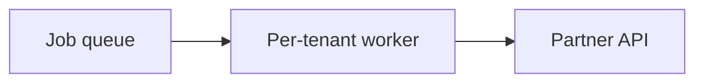

# Command Center: Brain View

When Command Center dispatches you, your prompt names a canvas file:
`~/.commandcenter/brain/<jobId>/canvas.md`. The dashboard renders it on its
own page and refreshes as the file changes, and you already have permission
to write it.

## Whether to use it

It's optional, and most sessions never touch it. If you never write to it,
the dashboard shows nothing and nobody notices. Use it when a picture or a
worked-through structure would help the user follow along:

- A design or approach you're weighing
- A diagram of how the pieces fit
- Reasoning you're working through out loud on a hard call

It's not a progress log. Don't use it to narrate steps ("now running
tests"); that's what your terminal is for.

## How to write it

- **Rewrite the whole file each time.** It's your current state of
  thinking, not a log to append to. The user sees whatever's in the file now.
- **Markdown**, with fenced ```` ```mermaid ```` blocks for diagrams.
- **No raw HTML.**

````markdown
## Approach: split the sync job by tenant



Open question: whether retries share one budget across tenants.
````

Keep it current as your thinking changes, and clear out ideas you've
dropped so they don't read as the plan.
